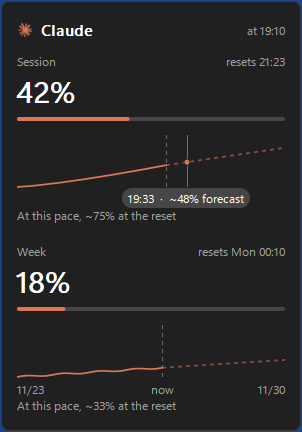
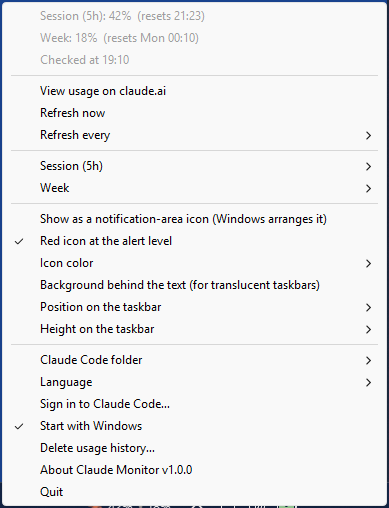

<div align="center">

# Claude Monitor

**Your Claude plan usage — session and week — right on the Windows taskbar.**

[](https://github.com/klsbecker/claude-monitor/actions/workflows/ci.yml)
[](https://github.com/klsbecker/claude-monitor/releases/latest)
[](LICENSE)
[](https://www.rust-lang.org)


**English** · [Português](docs/pt-BR/README.md) · [Español](docs/es/README.md)


</div>

Claude Monitor is a tiny native Windows app (one ~750 KB `.exe`, no runtime, no installer) that shows how much
of your Claude plan you have used: the **5-hour session** and the **weekly** limit, the same numbers as
[claude.ai/settings/usage](https://claude.ai/settings/usage).

## Features

- **Lives in the taskbar** — a slim strip next to the notification area, styled like the taskbar itself
  (light and dark themes, any DPI), or a single **notification-area icon** with both numbers stacked.
- **Hover card** with the current usage, progress bars, when each limit resets and a **chart of the whole
  window**. Hover the chart to read any point; a dashed line forecasts where the current pace ends up.
- **Notifications** when a limit reaches a level you choose, and (optionally) when it resets.
- **Alert colors** — numbers turn red from a chosen level; the icon can turn red too.
- **Configurable** from the menu: what to show, refresh interval, icon color, position and height on the
  taskbar, background plate for translucent taskbars, start with Windows.
- **English, Português (Brasil) and Español**, following the Windows language or chosen in the menu.
- **Several accounts** — pick which Claude Code folder to read the sign-in from (for example one per
  `CLAUDE_CONFIG_DIR`); folders like `~\.claude-work` are detected, and each account keeps its own history.
- **Sign-in helper** — if Claude Code is missing or signed out, it offers to install it and sign in.

<table>
  <tr>
    <td align="center"><br><sub>Hover card</sub></td>
    <td align="center"><br><sub>Menu</sub></td>
  </tr>
  <tr>
    <td align="center" colspan="2"><br><sub>Notification-area icon mode</sub></td>
  </tr>
</table>

## Install

Install with [winget](https://learn.microsoft.com/windows/package-manager/winget/):

```powershell
winget install KlsBecker.ClaudeMonitor
ClaudeMonitor
```

Then click the strip and tick **Start with Windows**. To update: `winget upgrade KlsBecker.ClaudeMonitor`.

<sub>The winget package is available once it is accepted in [winget-pkgs](https://github.com/microsoft/winget-pkgs).
Until then, or without winget, download `ClaudeMonitor.exe` from the
[latest release](https://github.com/klsbecker/claude-monitor/releases/latest) and run it from any folder;
running a newer `.exe` replaces the running one.</sub>

> **Requirements:** Windows 10 or 11 (x64) and a Claude Pro or Max plan signed in with
> [Claude Code](https://docs.anthropic.com/en/docs/claude-code). If Claude Code is not installed or not signed
> in, Claude Monitor offers to do both for you.

## Usage

| Action | Result |
| --- | --- |
| Hover the strip (or icon) | Card with numbers, reset times and charts |
| Hover a chart | Exact time and value under the cursor |
| Click (left or right) | Menu with details and every option |

The strip reads `42% • 18%`: session first, week second. A `!` means the last read failed (hover for the
reason) and `…` means it is still loading.

Command-line options: `--demo` shows made-up data (handy for screenshots), `--offset <px>` moves the strip
further from the notification area.

## How it works

```
Claude Code sign-in ──► ~/.claude/.credentials.json ──► Claude Monitor ──► api.anthropic.com/api/oauth/usage
                                                              │
                                     taskbar strip / icon ◄───┴──► %LOCALAPPDATA%\ClaudeMonitor\history.csv
```

- Every few minutes (5 by default) a background thread reads the usage with the OAuth token Claude Code
  saved. When the token has expired it is refreshed exactly like Claude Code does, and written back.
- Each reading is appended to a local history (8 days), which the charts and the forecast use.
- The strip is a layered child window of the taskbar, drawn pixel by pixel with GDI text and alpha blending,
  and kept just left of the notification area (and of other taskbar widgets).
- Settings live in `HKCU\Software\ClaudeMonitor`.

More detail in [docs/architecture.md](docs/architecture.md).

## Privacy

Claude Monitor talks only to Anthropic (`api.anthropic.com` for the usage, `platform.claude.com` to refresh
the token). It has no telemetry, sends nothing anywhere else and stores the history only on your machine.
See [SECURITY.md](SECURITY.md).

## Build from source

```powershell
git clone https://github.com/klsbecker/claude-monitor.git
cd claude-monitor
cargo build --release      # target\release\ClaudeMonitor.exe
cargo test
```

The toolchain is pinned in `rust-toolchain.toml` (rustup installs it). With Visual Studio Build Tools the
default MSVC toolchain just works; without them, `scripts\build-gnu.ps1` builds with the GNU toolchain.

## Contributing

Issues and pull requests are welcome — see [CONTRIBUTING.md](CONTRIBUTING.md) for the branch model, commit
style and code standards. Translations are especially welcome: a new language is one table in
[`src/i18n.rs`](src/i18n.rs).

## License

[MIT](LICENSE) © Klaus Becker

---

<sub>Claude Monitor is an independent project, not affiliated with or endorsed by Anthropic. "Claude" and
"Claude Code" are trademarks of Anthropic, PBC; the Claude glyph in `res/glyph.ico` belongs to Anthropic and is not covered by the MIT license. The usage endpoint it reads is the one Claude Code uses and may
change without notice.</sub>
