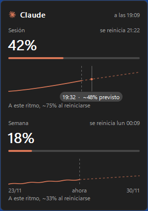
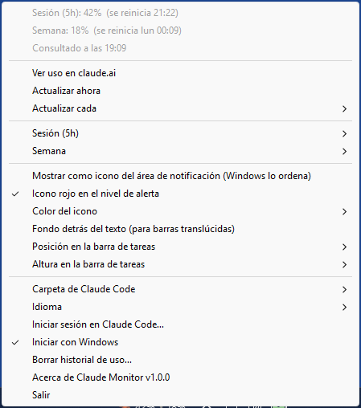

<div align="center">

# Claude Monitor

**El uso de tu plan de Claude (sesión y semana) directamente en la barra de tareas de Windows.**

[](https://github.com/klsbecker/claude-monitor/actions/workflows/ci.yml)
[](https://github.com/klsbecker/claude-monitor/releases/latest)
[](../../LICENSE)
[](https://www.rust-lang.org)


[English](../../README.md) · [Português](../pt-BR/README.md) · **Español**


</div>

Claude Monitor es una pequeña app nativa para Windows: un solo `.exe` de ~750 KB, sin runtime y sin
instalador. Muestra cuánto de tu plan de Claude ya usaste, tanto de la **sesión de 5 horas** como del límite
**semanal**. Son los mismos números de [claude.ai/settings/usage](https://claude.ai/settings/usage).

## Funciones

- **Vive en la barra de tareas:** una franja discreta junto al área de notificación, con el mismo estilo de la
  barra (tema claro u oscuro, cualquier DPI). Si lo prefieres, es un solo **icono del área de notificación**
  con los dos números apilados.
- **Tarjeta al pasar el ratón:** uso actual, barras de progreso, cuándo se reinicia cada límite y un
  **gráfico de toda la ventana**. Pasa el ratón por el gráfico para leer cualquier punto. Una línea discontinua
  muestra adónde llega el ritmo actual.
- **Notificaciones** cuando un límite llega al nivel que elijas y, si quieres, cuando se reinicia.
- **Colores de alerta:** los números se ponen rojos desde un nivel elegido, y el icono también puede hacerlo.
- **Configurable** desde el menú: qué mostrar, intervalo de actualización, color del icono, posición y altura
  en la barra, fondo para barras translúcidas e inicio con Windows.
- **En inglés, portugués (Brasil) y español.** Sigue el idioma de Windows o el que elijas en el menú.
- **Varias cuentas:** elige de qué carpeta de Claude Code leer la sesión (por ejemplo, una por
  `CLAUDE_CONFIG_DIR`). Se detectan carpetas como `~\.claude-trabajo`, y cada cuenta tiene su propio historial.
- **Ayuda para iniciar sesión:** si Claude Code no está instalado o no tiene sesión, la app ofrece instalarlo
  e iniciar sesión.

<table>
  <tr>
    <td align="center"><br><sub>Tarjeta</sub></td>
    <td align="center"><br><sub>Menú</sub></td>
  </tr>
  <tr>
    <td align="center" colspan="2"><br><sub>Modo icono del área de notificación</sub></td>
  </tr>
</table>

## Instalación

Instala con [winget](https://learn.microsoft.com/es-es/windows/package-manager/winget/):

```powershell
winget install KlsBecker.ClaudeMonitor
ClaudeMonitor
```

Después haz clic en la franja y marca **Iniciar con Windows**. Para actualizar: `winget upgrade KlsBecker.ClaudeMonitor`.

<sub>El paquete de winget está disponible cuando sea aceptado en [winget-pkgs](https://github.com/microsoft/winget-pkgs).
Mientras tanto, o sin winget, descarga `ClaudeMonitor.exe` de la
[última release](https://github.com/klsbecker/claude-monitor/releases/latest) y ejecútalo desde cualquier carpeta;
abrir un `.exe` más nuevo reemplaza el que está en ejecución.</sub>

> **Requisitos:** Windows 10 u 11 (x64) y un plan Claude Pro o Max con sesión iniciada en
> [Claude Code](https://docs.anthropic.com/en/docs/claude-code). Si Claude Code no está instalado o no tiene
> sesión, Claude Monitor ofrece hacer ambas cosas.

## Uso

| Acción | Resultado |
| --- | --- |
| Pasar el ratón por la franja (o el icono) | Tarjeta con números, horas de reinicio y gráficos |
| Pasar el ratón por un gráfico | Hora y valor exactos bajo el cursor |
| Hacer clic (izquierdo o derecho) | Menú con detalles y todas las opciones |

La franja muestra `42% • 18%`: primero la sesión, después la semana. Un `!` significa que la última lectura
falló (pasa el ratón para ver el motivo). `…` significa que todavía está cargando.

Opciones de línea de comandos: `--demo` muestra datos inventados (útil para capturas) y `--offset <px>` aleja
la franja del área de notificación.

## Cómo funciona

```
Sesión de Claude Code ──► ~/.claude/.credentials.json ──► Claude Monitor ──► api.anthropic.com/api/oauth/usage
                                                                │
                                     franja / icono en la barra ◄┴──► %LOCALAPPDATA%\ClaudeMonitor\history.csv
```

- Cada pocos minutos (5 por defecto), un hilo lee el uso con el token OAuth que guardó Claude Code. Cuando el
  token caduca, la app lo renueva igual que Claude Code y guarda el nuevo.
- Cada lectura se añade a un historial local de 8 días, que alimenta los gráficos y la previsión.
- La franja es una ventana hija de la barra de tareas, dibujada píxel a píxel con texto GDI y transparencia.
  Siempre queda a la izquierda del área de notificación y de otros widgets de la barra.
- La configuración se guarda en `HKCU\Software\ClaudeMonitor`.

Más detalles en [docs/architecture.md](../architecture.md) (en inglés).

## Privacidad

Claude Monitor solo se comunica con Anthropic: `api.anthropic.com` para el uso y `platform.claude.com` para
renovar el token. No tiene telemetría, no envía nada a ningún otro sitio y guarda el historial solo en tu
equipo. Consulta [SECURITY.md](../../SECURITY.md).

## Compilar

```powershell
git clone https://github.com/klsbecker/claude-monitor.git
cd claude-monitor
cargo build --release      # target\release\ClaudeMonitor.exe
cargo test
```

La versión de Rust está fijada en `rust-toolchain.toml`, y rustup la instala sola. Con Visual Studio Build
Tools, el toolchain MSVC por defecto funciona directamente. Sin ellas, usa `scripts\build-gnu.ps1`, que compila
con el toolchain GNU.

## Contribuir

Los issues y pull requests son bienvenidos. Consulta [CONTRIBUTING](CONTRIBUTING.md) para el modelo de ramas,
el formato de los commits y los estándares de código. Las traducciones ayudan mucho: un idioma nuevo es solo
una tabla en [`src/i18n.rs`](../../src/i18n.rs).

## Licencia

[MIT](../../LICENSE) © Klaus Becker

---

<sub>Claude Monitor es un proyecto independiente, sin relación con Anthropic ni respaldado por ella. "Claude"
y "Claude Code" son marcas registradas de Anthropic, PBC. El símbolo de Claude en `res/glyph.ico` pertenece a Anthropic y no está cubierto por la licencia MIT. El endpoint de uso que lee la app es el mismo que usa
Claude Code y puede cambiar sin aviso.</sub>
