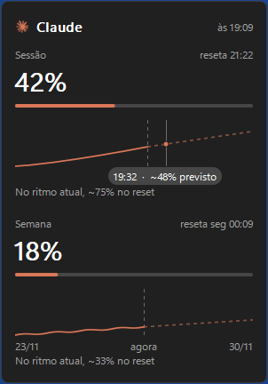
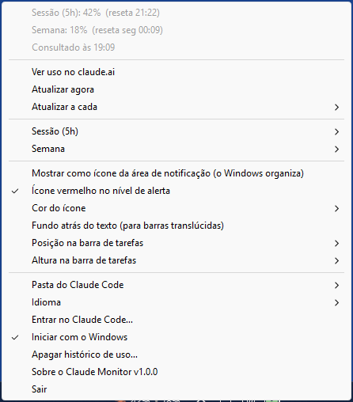

<div align="center">

# Claude Monitor

**O uso do seu plano do Claude (sessão e semana) direto na barra de tarefas do Windows.**

[](https://github.com/klsbecker/claude-monitor/actions/workflows/ci.yml)
[](https://github.com/klsbecker/claude-monitor/releases/latest)
[](../../LICENSE)
[](https://www.rust-lang.org)


[English](../../README.md) · **Português** · [Español](../es/README.md)


</div>

O Claude Monitor é um app nativo e pequeno para Windows: um único `.exe` de ~750 KB, sem runtime e sem
instalador. Ele mostra quanto do seu plano do Claude você já usou, tanto da **sessão de 5 horas** quanto do
limite **semanal**. São os mesmos números de [claude.ai/settings/usage](https://claude.ai/settings/usage).

## Recursos

- **Fica na barra de tarefas:** uma faixa discreta ao lado da área de notificação, com o mesmo visual da barra
  (tema claro ou escuro, qualquer DPI). Se preferir, vira um único **ícone da área de notificação** com os dois
  números empilhados.
- **Card ao passar o mouse:** uso atual, barras de progresso, quando cada limite reseta e um **gráfico da
  janela inteira**. Passe o mouse no gráfico para ler qualquer ponto. Uma linha tracejada mostra onde o ritmo
  atual vai chegar.
- **Notificações** quando um limite chega ao nível que você escolher e, se quiser, quando ele reseta.
- **Cores de alerta:** os números ficam vermelhos a partir de um nível escolhido, e o ícone também pode ficar.
- **Configurável** pelo menu: o que mostrar, intervalo de atualização, cor do ícone, posição e altura na barra,
  fundo para barras translúcidas e iniciar com o Windows.
- **Em inglês, português (Brasil) e espanhol.** Segue o idioma do Windows ou o que você escolher no menu.
- **Várias contas:** escolha de qual pasta do Claude Code ler o login (por exemplo, uma por
  `CLAUDE_CONFIG_DIR`). Pastas como `~\.claude-pessoal` são detectadas, e cada conta tem o seu próprio histórico.
- **Ajuda no login:** se o Claude Code não estiver instalado ou estiver sem login, o app oferece instalar e
  entrar na conta.

<table>
  <tr>
    <td align="center"><br><sub>Card</sub></td>
    <td align="center"><br><sub>Menu</sub></td>
  </tr>
  <tr>
    <td align="center" colspan="2"><br><sub>Modo ícone da área de notificação</sub></td>
  </tr>
</table>

## Instalação

Instale pelo [winget](https://learn.microsoft.com/pt-br/windows/package-manager/winget/):

```powershell
winget install KlsBecker.ClaudeMonitor
ClaudeMonitor
```

Depois clique na faixa e marque **Iniciar com o Windows**. Para atualizar: `winget upgrade KlsBecker.ClaudeMonitor`.

<sub>O pacote do winget fica disponível depois de aceito no [winget-pkgs](https://github.com/microsoft/winget-pkgs).
Até lá, ou sem o winget, baixe o `ClaudeMonitor.exe` da
[última release](https://github.com/klsbecker/claude-monitor/releases/latest) e rode de qualquer pasta.
Abrir um `.exe` mais novo substitui o que está rodando.</sub>

> **Requisitos:** Windows 10 ou 11 (x64) e um plano Claude Pro ou Max com login no
> [Claude Code](https://docs.anthropic.com/en/docs/claude-code). Se o Claude Code não estiver instalado ou
> estiver sem login, o Claude Monitor oferece fazer as duas coisas.

## Uso

| Ação | Resultado |
| --- | --- |
| Passar o mouse na faixa (ou no ícone) | Card com números, horários de reset e gráficos |
| Passar o mouse num gráfico | Horário e valor exatos sob o cursor |
| Clicar (esquerdo ou direito) | Menu com detalhes e todas as opções |

A faixa mostra `42% • 18%`: primeiro a sessão, depois a semana. Um `!` quer dizer que a última leitura falhou
(passe o mouse para ver o motivo). `…` quer dizer que ainda está carregando.

Opções de linha de comando: `--demo` mostra dados inventados (útil para prints) e `--offset <px>` afasta a faixa
da área de notificação.

## Como funciona

```
Login do Claude Code ──► ~/.claude/.credentials.json ──► Claude Monitor ──► api.anthropic.com/api/oauth/usage
                                                               │
                                     faixa / ícone na barra ◄──┴──► %LOCALAPPDATA%\ClaudeMonitor\history.csv
```

- A cada poucos minutos (5 por padrão), uma thread lê o uso com o token OAuth salvo pelo Claude Code. Quando o
  token expira, o app o renova do mesmo jeito que o Claude Code faz e grava o token novo.
- Cada leitura vai para um histórico local de 8 dias, que alimenta os gráficos e a previsão.
- A faixa é uma janela filha da barra de tarefas, desenhada pixel a pixel com texto GDI e transparência. Ela
  fica sempre à esquerda da área de notificação e de outros widgets da barra.
- As configurações ficam em `HKCU\Software\ClaudeMonitor`.

Mais detalhes em [docs/architecture.md](../architecture.md) (em inglês).

## Privacidade

O Claude Monitor só se comunica com a Anthropic: `api.anthropic.com` para o uso e `platform.claude.com` para
renovar o token. Não tem telemetria, não manda nada para outro lugar e guarda o histórico só na sua máquina.
Veja o [SECURITY.md](../../SECURITY.md).

## Compilar

```powershell
git clone https://github.com/klsbecker/claude-monitor.git
cd claude-monitor
cargo build --release      # target\release\ClaudeMonitor.exe
cargo test
```

A versão do Rust está fixada no `rust-toolchain.toml`, e o rustup instala sozinho. Com o Visual Studio Build
Tools, o toolchain MSVC padrão funciona direto. Sem ele, use o `scripts\build-gnu.ps1`, que compila com o
toolchain GNU.

## Contribuir

Issues e pull requests são bem-vindos. Veja o [CONTRIBUTING](CONTRIBUTING.md) para o modelo de branches, o
formato dos commits e os padrões de código. Traduções ajudam muito: um idioma novo é só uma tabela no
[`src/i18n.rs`](../../src/i18n.rs).

## Licença

[MIT](../../LICENSE) © Klaus Becker

---

<sub>O Claude Monitor é um projeto independente, sem vínculo com a Anthropic e sem endosso dela. "Claude" e
"Claude Code" são marcas registradas da Anthropic, PBC. O símbolo do Claude em `res/glyph.ico` pertence à Anthropic e não está coberto pela licença MIT. O endpoint de uso que o app lê é o mesmo que o Claude
Code usa e pode mudar sem aviso.</sub>
